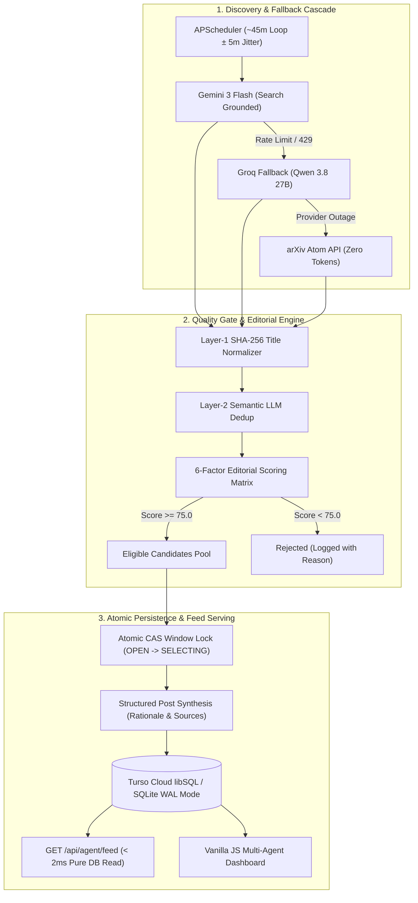

<div align="center">

# ⚡ Tron / Autonoma

**Autonomous Quality-Driven Intelligence Publisher with 3-Tier Failover & Sub-Millisecond Reads**

[](https://www.python.org/)
[](https://fastapi.tiangolo.com/)
[](https://aistudio.google.com/)
[](https://console.groq.com/)
[](https://turso.tech/)
[](https://www.docker.com/)

</div>

---

## 1. Executive Overview & Key Differentiators

Most autonomous news agents fail in production due to three architectural flaws:
1. **Request-Path Token Burn:** Triggering LLM inference on incoming HTTP requests causes volatile latency, rate-limit outages, and runaway token bills.
2. **Brittle Deduplication:** Simple SHA-256 string hashing fails on syntactic variations of the same event (e.g., *"OpenAI releases model"* vs. *"New model released by OpenAI"*).
3. **Absence of Editorial Judgment:** Scraping without rigorous multi-factor scoring floods channels with press releases and marketing fluff.

**Tron / Autonoma** engineers an industrial-grade solution:

* **Decoupled Asynchronous Synthesis vs. Sub-5ms Reads:** The public feed (`GET /api/agent/feed`) performs **zero LLM inference** and executes purely against indexed local SQLite WAL or Turso Cloud records in **$< 2\text{ ms}$**.
* **3-Tier Cascade Failover:** Google Gemini (`gemini-3-flash-preview`) with Search Grounding $\to$ Groq Cloud high-speed fallback (`qwen/qwen3.8-27b`) $\to$ zero-token arXiv Atom API.
* **Dual-Layer Deduplication:** Layer-1 deterministic SHA-256 title normalizer $\to$ Layer-2 semantic LLM deduplicator with prompt-injection sanitization.
* **Rigorous 6-Factor Editorial Engine:** 100-point rubric strictly enforcing a **$\ge 75.0$** cutoff threshold.
* **Atomic Compare-And-Swap (CAS) Concurrency:** A thread-safe state machine (`OPEN` $\to$ `SELECTING` $\to$ `PUBLISHED`) mathematically guaranteeing at most **one** post publishes per window.
* **Server-Side 5-Agent Cap:** Multi-persona support bounded by atomic FIFO rotation at both application (`asyncio.Lock`) and database (`threading.Lock` + post-insert prune) layers.

---

## 2. System Architecture



---

## 3. 6-Factor Editorial Scoring Matrix

Every candidate story is evaluated across 6 dimensions totaling 100 points. Only candidates scoring **$\ge 75.0$** qualify for window leadership and publication:

| Dimension | Points | Description & Evaluation Rubric |
| :--- | :---: | :--- |
| **Significance** | **25 pts** | Magnitude of technical impact, breakthrough importance, or industry architecture disruption. |
| **Recency** | **20 pts** | Publication freshness discovered within the current active publishing cycle. |
| **Domain Relevance** | **20 pts** | Strict conceptual alignment with the persona's specialized technical domain. |
| **Source Quality** | **15 pts** | Credibility of provenance (peer-reviewed arXiv paper, official engineering repo, primary CVE). |
| **Novelty** | **10 pts** | Distinctiveness from the last 50 published stories (verified via semantic and hash memory). |
| **Verifiability** | **10 pts** | Availability of accessible, verified primary source HTTP/HTTPS URLs with reproducible proofs. |
| **Total** | **100 pts** | **Minimum Passing Threshold: $\ge 75.0$** (Scores $< 75.0$ are rejected with reasons). |

---

## 4. Project Structure

```text
Tron/
├── config/
│   ├── models.py                 # Active LLM provider model strings
│   ├── persona_engine.py         # Dynamic system prompt & stance generation
│   └── settings.py               # Pydantic v2 application settings & env loader
├── services/
│   ├── autonomous_publisher.py   # Publishing window coordinator & CAS transition
│   ├── editorial_engine.py       # 6-factor scorer & semantic deduplicator
│   ├── llm.py                    # Multi-provider client (Gemini -> Groq fallback)
│   ├── memory.py                 # SQLite WAL store & Turso cloud pipeline adapter
│   ├── topic_discovery.py        # Search grounding & arXiv Atom XML fallback
│   └── turso_client.py           # Native libSQL HTTP pipeline client
├── static/
│   ├── app.js                    # Vanilla ES6+ client (theme, countdown, health telemetry)
│   ├── index.html                # Zero-build responsive dashboard
│   └── styles.css                # Dark/Light CSS custom property design system
├── tests/
│   ├── test_audit_comprehensive.py # Full suite covering DB, CAS, API, and personas
│   ├── test_autonomy_integration.py# 48-hour accelerated window simulation
│   ├── test_discovery_fallback.py  # 3-tier cascade and arXiv XML parser tests
│   ├── test_duplicate_prevention.py# Layer-1 hash and Layer-2 semantic tests
│   ├── test_editorial_and_twitter.py# 6-factor scoring boundaries and synthesis
│   ├── test_hackathon_spec.py      # Evaluator API contract and FIFO rotation
│   ├── test_llm_service.py         # Provider failure failover & schema tests
│   ├── test_migration_integrity.py # Source attribution and boundary tests
│   ├── test_security_hardening.py  # Pydantic extra="forbid", rate limiter & injection
│   └── test_t30_publisher.py       # T-30 sequential fallback execution
├── utils/
│   ├── duplicate.py              # SHA-256 topic hash & URL normalizers
│   └── prompt_sanitizer.py       # Injection filter & control character sanitizer
├── Dockerfile                    # Hardened multi-stage non-root container build
├── docker-compose.yml            # Production container configuration with persistent volume
├── render.yaml                   # Render Cloud Blueprint with health check path
├── main.py                       # FastAPI application entrypoint & background scheduler
└── requirements.txt              # Production dependency specifications
```

---

## 5. Quickstart

### Prerequisites
* Python 3.11+
* Gemini API Key ([Google AI Studio](https://aistudio.google.com/))
* Groq API Key ([Groq Console](https://console.groq.com/))

### Local Development Setup

```bash
# 1. Clone the repository
git clone https://github.com/vicode-org/Tron.git
cd Tron

# 2. Create and activate a clean virtual environment
python3 -m venv venv
source venv/bin/activate

# 3. Install production dependencies
pip install --upgrade pip
pip install -r requirements.txt

# 4. Configure environment credentials
cp .env.example .env
# Edit .env and supply GEMINI_API_KEY and GROQ_API_KEY

# 5. Execute complete test suite (73 tests)
PYTHONPATH=. pytest -v

# 6. Boot the application with a single Uvicorn worker
uvicorn main:app --host 0.0.0.0 --port 8080 --workers 1
```

Access the dashboard at `http://localhost:8080/` and interactive API documentation at `http://localhost:8080/docs`.

### Docker Production Deployment

> [!IMPORTANT]
> Always execute Uvicorn with `--workers 1`. APScheduler runs in-process; running multiple workers will spawn duplicate, uncoordinated background discovery cycles.

```bash
# Build the hardened multi-stage container
docker build -t tron-autonoma .

# Run container as non-root user (appuser:1001)
docker run -d \
  --name tron-production \
  -p 8080:8080 \
  --env-file .env \
  tron-autonoma
```

Alternatively, launch using Docker Compose:

```bash
docker compose up -d
```

---

## 6. Environment Variables Reference

All settings are strongly typed and parsed via Pydantic v2:

| Variable | Required | Default | Description |
| :--- | :---: | :---: | :--- |
| `PORT` | No | `8080` | HTTP server listening port. |
| `GEMINI_API_KEY` | **Yes** | `""` | Primary LLM key for structured reasoning and Search Grounding. |
| `GEMINI_MODEL` | No | `gemini-3-flash-preview` | Active Google Gemini model name. |
| `GROQ_API_KEY` | **Yes** | `""` | Fallback LLM key for high-speed failover. |
| `GROQ_MODEL` | No | `qwen/qwen3.8-27b` | Active Groq Cloud fallback model. |
| `LLM_PRIMARY_PROVIDER` | No | `gemini` | Primary AI provider routing identifier. |
| `LLM_FALLBACK_PROVIDER` | No | `groq` | Secondary AI provider routing identifier. |
| `TURSO_DATABASE_URL` | No | `""` | Remote libSQL URL (`libsql://...`) for persistent cloud memory. |
| `TURSO_AUTH_TOKEN` | No | `""` | Turso JWT authentication token. |
| `AGENT_DB_PATH` | No | `agent_memory.db` | Local SQLite database filename (used when Turso is unset). |
| `DISCOVERY_INTERVAL_MINUTES` | No | `45` | Background discovery scheduler interval in minutes. |
| `DISCOVERY_JITTER_SECONDS` | No | `300` | Randomized scheduling offset ($\pm\text{seconds}$) to prevent burst spikes. |
| `PUBLISH_WINDOW_MINUTES` | No | `45` | Duration of each publishing window in minutes. |
| `MIN_NEWS_SCORE` | No | `75.0` | Minimum 6-factor score required for a candidate to publish. |
| `MAX_AGENTS` | No | `5` | Maximum active concurrent personas before FIFO rotation. |
| `ENABLE_DOCS` | No | `false` | Enable Swagger (`/docs`) and ReDoc (`/redoc`) in dev mode. |
| `CORS_ORIGINS` | No | `*` | Comma-separated allowed HTTP origins for browser clients. |
| `MUTATION_RATE_LIMIT_PER_MINUTE` | No | `30` | In-memory sliding-window limit on `POST`/`DELETE` mutations. |
| `ADMIN_API_KEY` | No | `""` | Secret header key for manual testing triggers (`X-Admin-Key`). |

---

## 7. REST API Reference

| Method | Endpoint | Description | Latency / Notes |
| :--- | :--- | :--- | :--- |
| `GET` | `/health` / `/healthz` | System health, scheduler status, and telemetry. | $< 1\text{ ms}$ (No auth) |
| `GET` | `/readyz` | Kubernetes / Render readiness probe. | $< 1\text{ ms}$ (No auth) |
| `GET` | `/` / `/dashboard` | Responsive Vanilla HTML5/CSS3 dashboard. | Static asset delivery |
| `GET` | `/docs` / `/redoc` | Interactive OpenAPI documentation. | Gated by `ENABLE_DOCS` |
| `GET` | `/api/agents` | List active agent cards (up to 5) with window status. | $< 2\text{ ms}$ (Pure DB) |
| `POST` | `/api/agent/init` | Register a new agent persona (enforces 5-agent FIFO). | Rate limited (30/min) |
| `DELETE` | `/api/agent/{agent_id}` | Atomically evict an agent and all owned records. | Rate limited (30/min) |
| `GET` | `/api/agent/feed` | Reverse-chronological published articles. | **$< 2\text{ ms}$ (Zero LLM calls)** |
| `GET` | `/api/agent/status` | Real-time window state, leader story, and countdown. | $< 2\text{ ms}$ (Pure DB) |
| `POST` | `/api/agent/cycle` | Manually trigger a discovery cycle (testing). | Requires `X-Admin-Key` if set |
| `POST` | `/api/agent/close-window`| Manually trigger CAS window close evaluation. | Requires `X-Admin-Key` if set |
| `GET` | `/metrics` | Statistical reporting on posts, agents, and windows. | Monitoring telemetry |

---

## 8. Dashboard Highlights

The frontend located in [`static/`](file:///Users/apple/Desktop/Tron/static/) is a zero-build, dependency-free Vanilla ES6+ single-page interface:

* **Dark & Light Themes:** Toggleable UI persisted across browser restarts via `localStorage` and dynamic CSS variables.
* **Multi-Agent Management:** Visualizes up to 5 concurrent agent personas with real-time window status badges (`OPEN`, `SELECTING`, `PUBLISHED`).
* **Server-Side Limit Modals:** Automatically prompts the user when adding a 6th agent to confirm FIFO rotation of the oldest persona.
* **Live Telemetry & Countdown:** Tracks window expiration time and real-time candidate scores.
* **XSS Defense:** 100% escaped DOM rendering (`escapeHtml()`, `.textContent`) and strict URL validation blocking `javascript:` schemes.
